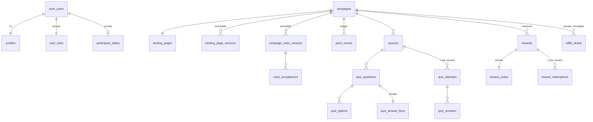

# Base de datos

PostgreSQL 17 en Supabase. Migraciones en `supabase/migrations/` (aditivas, nunca editadas tras aplicarse).
Los invariantes se comprueban en `tests/*.test.ts` sobre el SQL.

## Diagrama

## Tablas

| Tabla | Propósito | Invariantes |
| --- | --- | --- |
| `public.profiles` | Datos del participante, `passport_code`, teléfono, consentimientos | Alias único (case-insensitive) y filtrado; datos históricos del alta inmutables |
| `private.user_roles` | Rol (`participant`/`admin`/`superadmin`) | Nunca desde metadata; ≥ 1 superadmin |
| `private.participant_states` | `active`/`suspended`/`disqualified`/`archived` | Solo `active` gana puntos |
| `public.campaigns` | Campaña, fechas, premio, configuración del ranking | Una sola `published` |
| `public.landing_pages` / `_versions` | Portada borrador/publicada e historial | Historial inmutable |
| `public.campaign_rules_versions` / `rules_acceptances` | Reglas versionadas y aceptaciones | Versiones inmutables |
| `public.point_events` | **Ledger de puntos** | Solo inserción; único por (campaña, usuario, tipo, origen); reversión única |
| `public.quizzes`, `quiz_questions`, `quiz_options` | Trivias | Bloqueo por trigger tras el primer intento |
| `private.quiz_answer_keys` | Respuesta correcta y explicación | Nunca expuesta antes del cierre |
| `public.quiz_attempts` / `quiz_answers` | Intentos y respuestas | `unique(quiz_id, user_id)`; plazo del servidor |
| `public.rewards` / `private.reward_codes` | Misiones y su código | Código privado, regenerable |
| `public.reward_redemptions` | Canjes | `unique(user_id, reward_id)` (código = QR) |
| `private.redeem_attempts` | Intentos de canje | Límite 10 fallos / 10 min |
| `private.audit_log` | Auditoría | Solo inserción |
| `private.raffle_draws` | Sorteos | Inmutable; semilla + huella de la lista |

## Funciones clave

- **Internas:** `require_role`, `write_audit`, `current_campaign_id`, `award_points`, `campaign_standings`,
  `finalize_attempt`, `speed_bonus`, `new_reward_code`, `raffle_eligible`.
- **Participante:** `get_my_points`, `list_my_quizzes`, `start_quiz_attempt`, `save_quiz_answer`,
  `submit_quiz_attempt`, `get_quiz_result`, `preview_reward`, `redeem_reward`, `update_my_profile`,
  `update_my_contact`, `accept_current_rules`.
- **Públicas (anon):** ver `SECURITY.md`.
- **Admin (`admin_*`):** todas empiezan con `require_role` y las que mutan escriben `write_audit`.

## Ranking

`private.campaign_standings`: puntos = suma del ledger; desempate por aciertos y luego eventos completados (regla 7),
excluyendo estadísticas de movimientos revertidos. `RANK()` deja empates con la misma posición. Compiten solo
participantes `active`/`suspended` con perfil completo.
